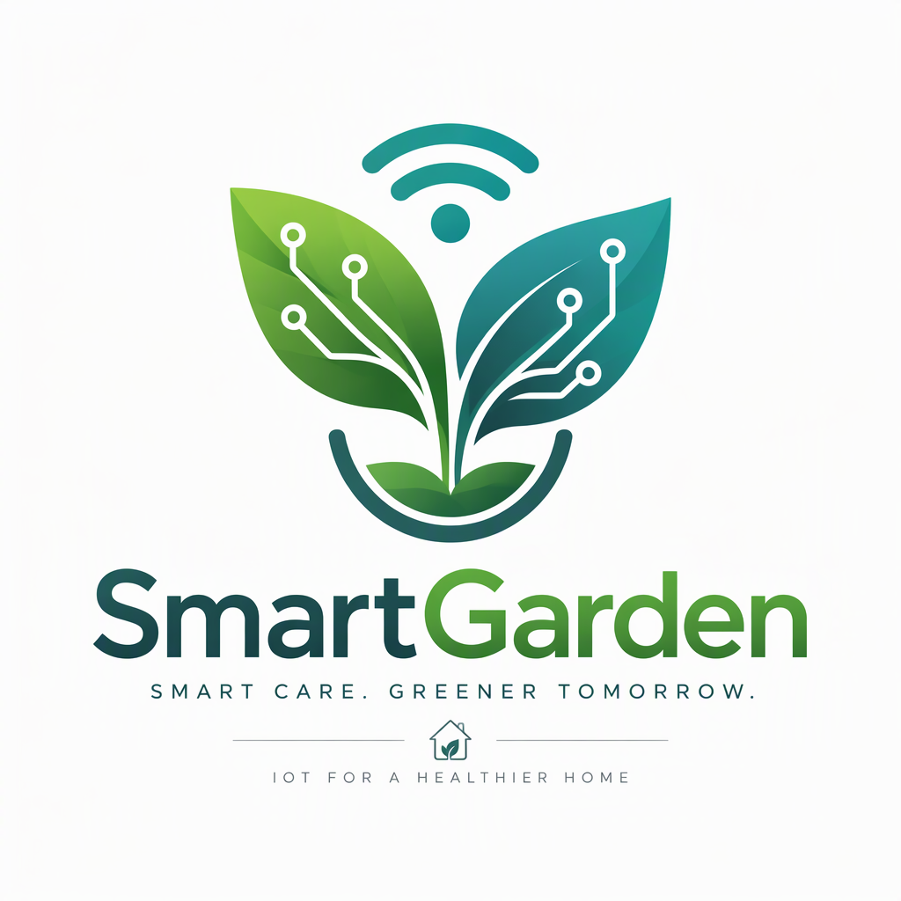

<div align="center">



# SmartGarden

### IoT-Powered Smart Garden Automation System

[](LICENSE)
[]()
[]()
[]()

**Made by [AARUTO](https://github.com/AARUTO347)**

[Features](#-features) • [Hardware](#-hardware) • [Installation](#-installation) • [Usage](#-usage) • [API](#-api)

</div>

---

## About

SmartGarden is an IoT-based garden automation system that monitors and controls your garden's environment. It uses sensors to track soil moisture, temperature, humidity, and light levels — then automatically waters your plants when needed.

Built with Arduino/ESP32 microcontrollers, SmartGarden brings intelligence to your garden while keeping things simple and affordable.

## Features

### Monitoring

- **Soil Moisture** — Real-time moisture level tracking
- **Temperature** — Ambient temperature monitoring
- **Humidity** — Air humidity sensing
- **Light Levels** — Photosynthetically active radiation tracking
- **Water Tank Level** — Know when to refill

### Automation

- **Automatic Watering** — Water plants when soil is dry
- **Scheduled Watering** — Set custom watering schedules
- **Smart Thresholds** — Configurable trigger levels
- **Pump Control** — Relay-controlled water pump
- **Override Mode** — Manual control when needed

### Connectivity

- **WiFi Connected** — ESP32/ESP8266 wireless support
- **Web Dashboard** — Monitor from any browser
- **Mobile Friendly** — Responsive design
- **API Access** — RESTful API for integration
- **OTA Updates** — Over-the-air firmware updates

### Data & Analytics

- **Historical Data** — Track trends over time
- **Real-time Graphs** — Live sensor visualization
- **Data Logging** — SD card or cloud storage
- **Alerts** — Email/notifications for critical conditions

## Hardware

### Required Components

| Component | Purpose | Recommended |
|-----------|---------|-------------|
| Microcontroller | Brain | ESP32 DevKit v1 |
| Soil Moisture Sensor | Measure soil water | Capacitive v1.2 |
| DHT22 / DHT11 | Temperature & humidity | DHT22 (more accurate) |
| LDR / BH1750 | Light level | BH1750 (digital) |
| Water Pump | Irrigation | 5V/12V submersible |
| Relay Module | Pump control | 5V single channel |
| Power Supply | System power | 5V 2A USB |
| Jumper Wires | Connections | Male-female, male-male |
| Breadboard / PCB | Assembly | Per project |

### Optional Components

| Component | Purpose |
|-----------|---------|
| Water Level Sensor | Tank monitoring |
| OLED Display | Local status display |
| RTC Module (DS3231) | Accurate timekeeping |
| SD Card Module | Data logging |
| Solar Panel | Off-grid power |
| Rain Sensor | Weather awareness |

### Wiring Diagram

```
ESP32 Pin Connections:
┌─────────────────────────────────────┐
│  GPIO 34 ← Soil Moisture (Analog)   │
│  GPIO 4  ← DHT22 Data               │
│  GPIO 35 ← LDR (Analog)             │
│  GPIO 26 → Relay (Pump Control)     │
│  GPIO 33 ← Water Level (Analog)     │
│  3.3V    → Sensor Power             │
│  GND     → Common Ground            │
└─────────────────────────────────────┘
```

> **Note:** Adjust pins based on your board. See [Wiring Guide](docs/wiring.md) for detailed diagrams.

## Installation

### Firmware Setup

1. **Install Arduino IDE** or **PlatformIO**

2. **Install Required Libraries:**
   ```
   - WiFiManager (for ESP WiFi setup)
   - DHT sensor library
   - Adafruit Unified Sensor
   - ArduinoJson
   - WebSockets (optional, for real-time updates)
   ```

3. **Clone this repository:**
   ```bash
   git clone https://github.com/AARUTO347/smartgarden.git
   cd smartgarden
   ```

4. **Configure Settings:**
   
   Edit `config.h`:
   ```cpp
   #define SOIL_PIN 34
   #define DHT_PIN 4
   #define LDR_PIN 35
   #define RELAY_PIN 26
   #define DHT_TYPE DHT22
   
   // Thresholds
   #define SOIL_DRY_THRESHOLD 30    // % moisture
   #define SOIL_WET_THRESHOLD 70    // % moisture
   ##define TEMP_MAX 35             // °C
   ```

5. **Upload Firmware:**
   ```bash
   # Arduino IDE
   Open smartgarden.ino → Select Board → Upload
   
   # PlatformIO
   pio run --target upload
   ```

### First-Time WiFi Setup

1. Power on the device
2. Connect to WiFi network: `SmartGarden-Setup`
3. Open browser to: `http://192.168.4.1`
4. Enter your home WiFi credentials
5. Device will reconnect and show IP address on serial monitor

### Web Dashboard

Access the dashboard at your device's IP address:

```
http://<device-ip>/
```

## Usage

### Dashboard Controls

| Control | Function |
|---------|----------|
| **Status Panel** | Current sensor readings |
| **Manual Water** | Trigger pump manually |
| **Auto Mode** | Enable/disable automation |
| **Schedule** | Set watering times |
| **Thresholds** | Adjust trigger levels |
| **History** | View past data |
| **Settings** | Configure device |

### Automation Modes

**Manual Mode:**
- You control everything
- Pump only runs when you press the button

**Auto Mode:**
- System monitors soil moisture
- Waters automatically when dry
- Respects schedule and thresholds

**Scheduled Mode:**
- Waters at specific times
- Ignores sensor readings
- Good for consistent schedules

## API

SmartGarden exposes a RESTful API for integration:

### Endpoints

| Method | Endpoint | Description |
|--------|----------|-------------|
| GET | `/api/status` | Current sensor readings |
| GET | `/api/history` | Historical data |
| POST | `/api/pump/on` | Turn pump on |
| POST | `/api/pump/off` | Turn pump off |
| GET | `/api/config` | Get configuration |
| POST | `/api/config` | Update configuration |
| GET | `/api/schedule` | Get watering schedule |
| POST | `/api/schedule` | Set watering schedule |

### Example Requests

**Get Current Status:**
```bash
curl http://192.168.1.100/api/status
```

Response:
```json
{
  "soil_moisture": 45,
  "temperature": 24.5,
  "humidity": 60,
  "light_level": 850,
  "pump_status": false,
  "auto_mode": true,
  "last_watered": "2026-11-06T10:30:00Z"
}
```

**Turn Pump On:**
```bash
curl -X POST http://192.168.1.100/api/pump/on
```

## Project Structure

```
smartgarden/
├── smartgarden.ino       # Main firmware
├── config.h              # Configuration settings
├── src/
│   ├── sensors.cpp       # Sensor reading functions
│   ├── sensors.h
│   ├── pump.cpp          # Pump control
│   ├── pump.h
│   ├── wifi.cpp          # WiFi management
│   ├── wifi.h
│   ├── web.cpp           # Web server & API
│   └── web.h
├── data/
│   ├── index.html        # Web dashboard
│   ├── style.css
│   └── script.js
├── docs/
│   ├── wiring.md         # Wiring diagrams
│   ├── api.md            # Full API docs
│   └── troubleshooting.md
├── assets/
│   └── logo.png          # Project logo
└── README.md
```

## Troubleshooting

### Common Issues

**WiFi Connection Fails:**
- Check credentials in WiFi manager
- Ensure router is 2.4GHz (ESP32 doesn't support 5GHz)
- Move device closer to router during setup

**Sensor Reads 0 or Max:**
- Check wiring connections
- Verify sensor power (3.3V)
- Test with multimeter
- Ensure correct pin in config.h

**Pump Doesn't Run:**
- Check relay clicks when triggered
- Verify pump power supply
- Test pump directly with power
- Check relay pin in config.h

**Dashboard Won't Load:**
- Verify device IP address
- Check firewall settings
- Try different browser
- Restart device

See [Troubleshooting Guide](docs/troubleshooting.md) for more issues.

## Contributing

Contributions are welcome! Areas where help is needed:

- Additional sensor support
- Mobile app development
- Cloud integration (AWS IoT, Firebase)
- Machine learning for predictive watering
- Documentation improvements
- Bug fixes

Please open an issue or submit a pull request.

## Roadmap

- [ ] MQTT support for home automation integration
- [ ] Mobile app (React Native / Flutter)
- [ ] Cloud dashboard with historical charts
- [ ] Multiple zone support
- [ ] Weather API integration
- [ ] Camera module for plant monitoring
- [ ] Voice control (Alexa / Google Home)
- [ ] Battery power with solar charging

## License

**MIT** — see [LICENSE](LICENSE).

## Acknowledgments

- Arduino community for libraries and examples
- ESP32 developers for excellent hardware
- Open source IoT projects for inspiration

---

<div align="center">

**SmartGarden** — Smart Gardening Made Simple

Made by [AARUTO](https://github.com/AARUTO347)

[GitHub](https://github.com/AARUTO347/smartgarden) • [Issues](https://github.com/AARUTO347/smartgarden/issues) • [Wiki](https://github.com/AARUTO347/smartgarden/wiki)

</div>
